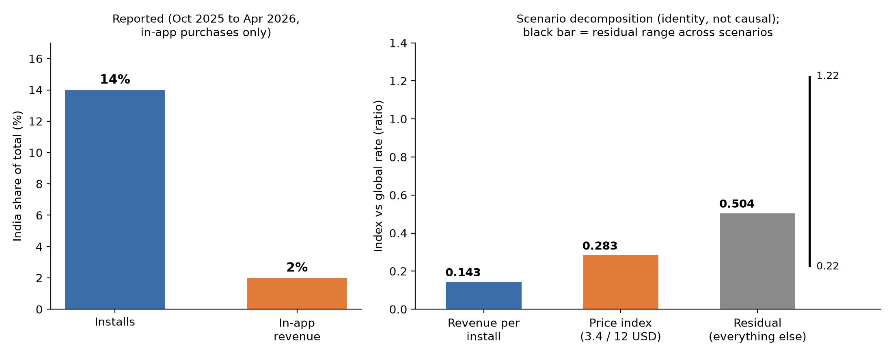
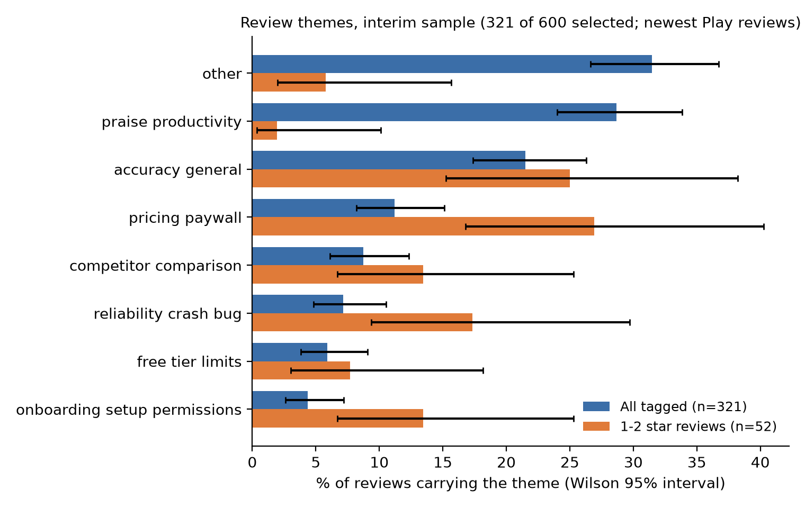
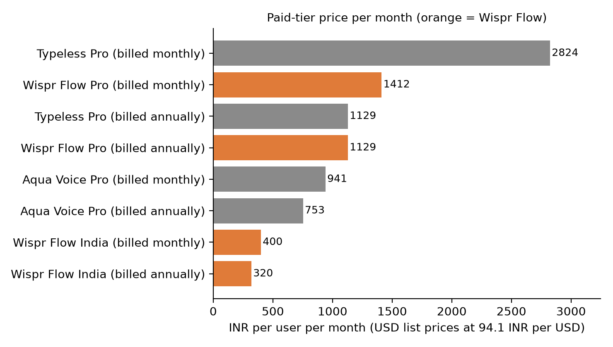
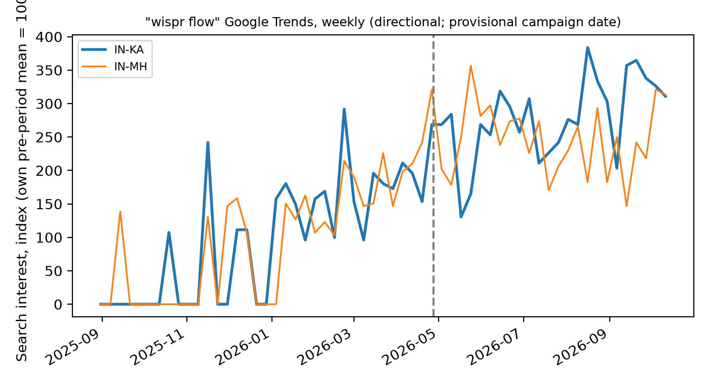

# Wispr Flow India: public-signals growth diagnostic

**Why is India about 14% of Wispr Flow's installs but about 2% of its in-app-purchase revenue, and what should the growth team test first?**
Reported figures say the gap is large. My scenario math says India's lower price accounts for only part of it, so the first experiments should test conversion levers (free-tier cap, Android setup) before simply cutting price. This is built entirely from public data: it is directional and does not establish causes.

| Open | |
|---|---|
| [Interactive dashboard (Looker Studio)](https://datastudio.google.com/reporting/bdcc93a1-66f1-4f6b-9496-c69d8ba01035) | charts and tables built from the workbook below |
| [Slide deck (Google Slides)](https://docs.google.com/presentation/d/1itgf-Vjq8WL_pxCx-8aFIfCaeLe-iqgf/edit?usp=sharing) | 10 slides; the repository copy is [outputs/deck/deck.pptx](outputs/deck/deck.pptx) |
| [Excel workbook](outputs/dashboard/wispr_dashboard_data.xlsx) | the data behind every dashboard page, one sheet per table |
| [Method](docs/methodology.md) · [Limitations](docs/limitations.md) · [Data dictionary](docs/data_dictionary.md) | how numbers were derived and what they cannot show |

> **Read this first.** There is no internal Wispr data. Everything is a public proxy: revenue is in-app purchases only, from one secondary source (Sensor Tower via TechCrunch); the review sample is interim (321 of 600 selected, newest Google Play reviews, not India-specific); competitor scores come from store listings and vendor claims; experiment baselines are illustrative. Every number carries a status (reported, derived, assumption, estimated, unknown) in an [audited ledger](data/ledger/numbers_ledger.csv).

## At a glance

*Revenue per install is 0.143 of the global rate. India's lower list price (3.4 vs 12 USD) is 0.283 of it, leaving a residual of 0.504 (0.223 to 1.224 across 12 scenarios). That is arithmetic, not causation: the residual lumps together conversion, plan mix and measurement.*


*Pricing is the most distinctive complaint among low-rated reviews (26.9% vs 11.2% overall; the intervals do not overlap). Interim sample, directional only.*


*India pricing (320 INR a month billed annually, 400 monthly) sits far below the USD list prices converted at the implied rate; only prices with a stated billing period are charted.*


*Search interest rose through 2026, but the Karnataka-versus-control comparison is **not estimable**: only 2 of 5 states had enough pre-period activity. Shown as context, not as an effect of the campaign.*

## Key findings
1. **The gap is real in the reported data, and price is only part of it.** 14% of installs against 2% of IAP revenue gives 0.143 revenue per install relative to the global rate; price alone is 0.283. *Why it matters:* a price cut cannot be assumed to close the gap. *Uncertain:* the residual is an arithmetic remainder (0.223 to 1.224 across scenarios), and IAP revenue excludes any billing outside the app stores. The company says India is its second-largest base, which with a 2% IAP share suggests much India revenue may be billed elsewhere (a hypothesis, not a finding).
2. **Pricing friction shows up among unhappy reviewers.** Pricing and paywall: 26.9% of 52 one- and two-star reviews against 11.2% of all 321 tagged. *Why it matters:* it points the first test at the paywall and free tier. *Uncertain:* interim, recency-biased Play sample, not India-specific; one labeller; tagger test micro-F1 0.784 (0.72 to 0.85), sentiment kappa 0.830.
3. **The nearest competitors are a free default and one dedicated rival.** Gboard scores 13 of 15 (free, preinstalled) and Superflow 11 on four known criteria (11 to 14 possible). *Why it matters:* the substitute for paying is often free typing, not another paid app. *Uncertain:* reach is global Play installs; the order of the top two changes if one criterion is dropped.
4. **Wispr's India price is far below global list, but only some competitor prices are comparable.** Items with no stated billing period are left unknown rather than compared.
5. **No Karnataka campaign effect can be claimed.** The search-interest comparison is not estimable on the available pre-period data.

## What I would test first (proposed, not run)
| Experiment | Metric | Sample per arm | Time incl. follow-up |
|---|---|---|---|
| E1 Android permission flow | first dictation within a day of install (baseline 30%, +5 points) | 1,376 | 10.0 to 29.2 days |
| E2 Free-tier cap level | paid conversion by day 14 (baseline 2%, +1 point) | 3,788 | 22.2 to 75.2 days |
| E3 Invite loop | invited users who complete a dictation (baseline 20%, +4 points) | 1,680 | 9.5 to 15.1 days |

These are sized to about 1,650 India installs a day (derived) with Android share, eligibility and exposure as explicit parameters; baselines and effect sizes are assumptions, and none of these experiments has been run. Details: [data/processed/experiment_sizing.csv](data/processed/experiment_sizing.csv) and the experiments page of the dashboard.

## Evidence quality
Reported: install and revenue shares, Wispr's India prices. Derived: the three indices and experiment sizes. Estimated: review-theme shares (Wilson 95% intervals) and tagger accuracy. Not estimable: the Karnataka comparison and any India-versus-US review comparison. The deck's numbers are checked against the ledger by an automated test, and key results are recomputed independently (see below).

## How it works
```
public sources ──► pulls (src/pulls) ──► data/raw, data/private (not distributed)
                                   └──► scrub + hash ──► gold set + tagger (src/tagging) ──► themes, metrics
curated evidence ──► numbers ledger + ASSUMPTIONS ──► analysis A1-A7 (src/analysis)
                                                   └──► dashboard tables + workbook + deck (src/deck)
```
Methodology, rules and formulas: [docs/methodology.md](docs/methodology.md). Review-tagging evaluation: [docs/tagging_eval.md](docs/tagging_eval.md). Fields and null semantics (why `unknown` is not zero and how suppressed values appear): [docs/data_dictionary.md](docs/data_dictionary.md).

### Data and coverage
Sources, dates and terms: [docs/sources.md](docs/sources.md) and [docs/source_log.md](docs/source_log.md). Reviews: 3,000 Google Play reviews (2026-03 to 2026-10, not partitioned by country) and two partial App Store pages for India and US that do not overlap, so an India-versus-US comparison is not estimable; Google Trends weekly for five states (Sep 2025 to Oct 2026); archived Wispr pricing pages (13 snapshots); Google Play listings for the competitors; vendor pricing and documentation pages.

## Repository layout
```
sql/               DuckDB queries for the core aggregations (theme shares and intervals, decomposition grid, price ladder)
src/analysis/      A1-A7 analysis modules (themes, competitors, trends, decomposition, value ladder, sizing, charts)
src/pulls/         Reviews, Trends, pricing snapshots and competitor listing pulls (rate-limited, logged)
src/transform/     Review parsing, scrubbing, hashing; price parser
src/tagging/       Gemini backend, tagger (dry run by default), gold set, bulk sample, evaluation with freeze guards
src/common/        Numbers ledger, ledger check, pull/failure logs
src/deck/          Deck, dashboard tables, workbook, layout check, per-page guide generator
tests/             pytest suite (schema rules, independent recomputation, regression tests)
data/ledger/       numbers_ledger.csv (every displayed number and its source or derivation)
data/processed/    Aggregated results and curated tables (no review text)
data/interim/      Trends series, competitor listing facts, evaluation results and run records
data/logs/         Pull and failure logs
outputs/           deck/deck.pptx, dashboard/ (CSVs + workbook), charts/
docs/              Methodology, data dictionary, sources, limitations, reproducibility, validation, research notes
```
Stack (from the imports): Python, SQL (DuckDB), pandas, numpy, scipy, statsmodels, matplotlib, python-pptx, openpyxl, requests, python-dotenv, google-play-scraper, pytrends, pytest and ruff; Google's Gemini API for tagging.

## Install, run, verify
```bash
make setup        # venv + dependencies (Python 3.12 used; 3.11+ expected to work)
make check        # pytest, ruff, number-to-ledger check on the deck, deck text-fit estimate
make reproduce    # regenerate everything that can be rebuilt from the repository, then check
```
`make reproduce` needs no network, key or private data. Raw acquisition and review tagging need network access, a free Gemini key and, for evaluation, your own labels; exact commands, environment variables and what cannot be reproduced are in [docs/reproducibility.md](docs/reproducibility.md). Copy `.env.example` to `.env` and fill in `HASH_SALT` (and `GEMINI_API_KEY` for tagging); never commit it.

### Verifying the results independently
`tests/test_independent_audit.py` recomputes review shares and Wilson intervals, the test-split F1 and kappa, the experiment sample sizes (a second formula) and the competitor reach scores with different code from the pipeline; `tests/test_deck_numbers.py` compares ledger values with recomputation; the ledger check fails if a number on a slide has no ledger row. Validation history and corrections: [docs/validation.md](docs/validation.md).

## Deliverables
- **Deck:** `outputs/deck/deck.pptx` (10 slides, generated; footnotes come from the ledger). Layout is checked by an estimate only, so open it once in PowerPoint before sharing.
- **Dashboard data:** `outputs/dashboard/` (eleven CSVs and `wispr_dashboard_data.xlsx`).
- **Looker Studio report:** built from the workbook in a Google account (steps in [docs/looker_studio_setup.md](docs/looker_studio_setup.md), per-page guides in `docs/looker/`). It is a manual build and is not refreshed by `make reproduce`; if the data change, re-upload the workbook.

## Limitations (summary)
Public proxies only; revenue is IAP only from one secondary source; the review sample is an interim, recency-biased subset; the gold set is small and single-labelled; competitor evidence is Play listings and developer claims; experiment baselines are illustrative. Full list: [docs/limitations.md](docs/limitations.md).

## Privacy, terms and licence
Review text, gold labels, hashed review IDs and raw pulls are not distributed; names, emails, phone numbers, handles and URLs are removed before any model call, and a real call needs an explicit flag. Source terms are noted in [docs/sources.md](docs/sources.md); Google Play and Google Trends are accessed through unofficial libraries, so check current terms before re-running. No licence file is included yet, so all rights are reserved by default until the repository owner adds one.
